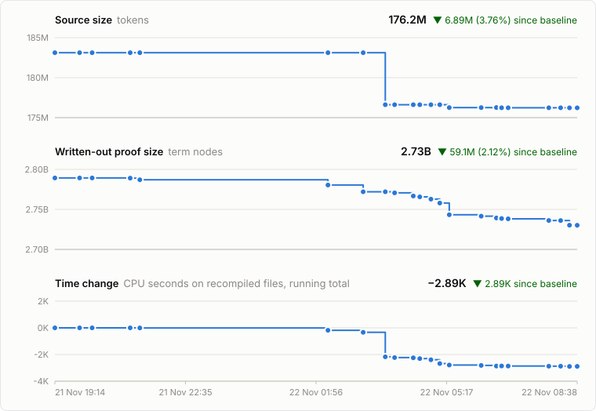

# GRH simplification drive

Working repository for simplifying Levent Alpöge's Lean proof of the Riemann Hypothesis and of GRH for
Dirichlet L-functions, announced on 2026-11-20 ([remark](https://alpo.ge/remark.pdf)).

This repository does not contain his archive. It contains the tools, the measurements, and our changes to
the proof as differences from the archive (`patches/`). The archive is fetched and checked by sha256.

## Goal

Make the proof smaller and easier to follow without changing what it proves: delete what is not needed,
share what is repeated, find shorter arguments.

## Where it stands

One point per recorded change, placed at the time of its commit.

<!-- dials:start -->
<picture>
  <source media="(prefers-color-scheme: dark)" srcset="metrics/dials-dark.svg">
  
</picture>

| Dial | Baseline | Now | Change |
|---|---:|---:|---:|
| Source size (tokens) | 183,118,239 | 176,105,982 | −7,012,257 |
| Written-out proof size (term nodes) | 2,789,304,299 | 2,719,481,805 | −69,822,494 |
| Time (CPU seconds on recompiled files, running total) | 0.0 | -2,830.5 | −2,830.5 |

Cone: 1,260,830 declarations in 146,531 files. Recorded changes: 26. Latest row: kept parts between dropped ones read by projection; second pass (171 lines; 125 files) (2026-11-22 10:50 UTC).
<!-- dials:end -->

## Milestones

| When | Milestone | Status |
|---|---|---|
| 2026-11-21 | Archive measured: what the five theorems depend on, and the three dials for it | done |
| 2026-11-21 | Judge working: a change is compiled, checked and measured before it is recorded | done |
| 2026-11-22 | First heavy proofs rewritten without taking large structures apart (waves 1 and 2) | done |
| 2026-11-22 | Restatements removed: 32,172 theorems that only repeated another theorem's statement and cited it are now aliases. Source size −3.5% | done |
| 2026-11-22 | Repetition measured: 28,313 statements are proved independently more than once ([details](campaign/repetition/RESULTS.md)) | done |
| 2026-11-22 | Repetition sweep, part 1: 10,064 duplicate proofs now cite a copy their file already imports (two passes), each citation in its shortest form. Written-out size −0.5%, source −0.2% | done |
| 2026-11-22 | Heaviest proofs, waves 2 to 6: 50 proofs rewritten by hand, each kind of cause written up with its fix ([notes](campaign/proof-shrink/RESULTS.md)) | done |
| | One shared lemma for 24 proofs that take the same record apart: 16 rewritten, 12.5 million nodes down to 0.6 million; not recorded | waits for the owner: the lemma needs one Lean tag the equivalence check sends to review |
| 2026-11-22 | Patterns that drop parts of a conjunction read the kept parts by projection instead of matching every part. 9,519 lines in 7,351 files, −18.7 million nodes, source down ([notes](campaign/proof-shrink/RESULTS.md)) | done |
| | Repetition sweep, part 2: duplicates in files that cannot see each other share one proof | needs a rule for added imports |
| | Heavy definitions built from chains of `choose` | next |
| | More waves on the heaviest proofs (wave 7 is running; proofs over 100,000 nodes are now only 2.8% of the whole, so returns are falling) | ongoing |
| | Sweep of repetitions: the same argument written out in many proofs | next |
| | Plain-language map of the argument: the chain at the top, the largest blocks under it and what each costs, where a shorter route might exist. Everything above is about how the proof is written; this is the first step on the mathematics | started |

## Fixed

- Lean v4.33.1 and Mathlib `0df444a` (tag v4.33.1). Mathlib is frozen and free; only what sits on top of it counts.
- The five theorems in `proof/src/Main.lean`: RH twice (Mathlib's statement and a written-out copy) and GRH
  for Dirichlet L-functions in three forms. A change is valid only if it still proves all five, using only the
  three standard axioms. In the archive RH is derived from the GRH statement, so the two targets need almost
  exactly the same material; the tools report the RH-only numbers alongside.

## How a change is judged

Everything is measured over the **cone**: the theorems and definitions outside Mathlib that the five theorems
actually depend on. Anything else in the tree does not count.

Three dials:

1. **Source size** of the cone, in tokens. A name of any length is one token; comments are not counted.
2. **Written-out proof size** of the cone: the size of the fully expanded proofs that Lean checks.
3. **Time** to build and check, compared on the files a change recompiles. Measured as the time Lean spends
   elaborating and checking those files, not counting the loading of what they import. Before and after are
   always measured on the same machine under the same load. Large batches are timed on a rented machine,
   sometimes on a random sample of their files (the history row then covers only the sample), so the running
   total adds seconds from different machines and is a rough indicator, not a benchmark.

A valid change is accepted if no dial goes up, and it is progress if one goes down. The two sizes are exact.
Time is noisier, so it has a tolerance, and a change that raises it beyond that is reviewed by a person.

One trade between dials is allowed without review: **source size may rise if the written-out size falls by
at least 1,000 nodes for every token added.** The cone averages about 15 nodes per token, so this only admits
changes that are far better than the going rate. Any other change that trades one dial for another needs a
written reason and a human decision.

Because a name of any length is one token, a chain of projections such as `h.2.2.1` is one token too. Changes
made in bulk that turn patterns into such chains are therefore held to a stricter count, in which every
projection step is a token, and file by file: a file is changed only if its written-out size falls and, if its
source grows on that count, by at least 1,000 nodes per token added.

Two fences:

- A size cap on any single theorem or definition that is added, or that is changed and grows
  (`baseline/caps.json`, provisional). New helper lemmas are welcome as long as they stay under it.
  A new helper may be over the cap when it replaces more than it adds: the cone's written-out size must
  fall by at least what the helper weighs.
- No new macros or notation.

Reported to steer the work, not enforced: which declarations most of the cone hangs on
(`tools/ablation.py`), what each known theorem costs on its own, and how often each definition is used.

## Setup

Needs Linux, about 70 GB of free disk and 16 GB of memory, and: `git`, `curl`, `python3`, `zstd`,
`bubblewrap`, `systemd-run`, and [elan](https://github.com/leanprover/elan) (Lean v4.33.1 is picked up from
the toolchain files).

```bash
# 1. The proof: fetch the archive (240 MB), check it, apply our patches. Creates proof/, a local git repository.
tools/setup_proof.sh

# 2. Mathlib, compiled, at the pinned revision (about 5 GB).
(cd proof && lake exe cache get)

# 3. The compiled base: the published build of the unmodified archive (28.6 GB download).
tools/fetch_compiled.sh

# 4. Read every compiled module once (about 15 minutes); keep the compiled files for per-file compiles
#    (99 GB unpacked; about a third of that on a compressing filesystem).
lake -d tools/moddump build
python3 tools/dump_stream.py --archive upstream-dl/compiled/oleans.tar.zst --out data/base --keep compiled/lib/lean

# 5. Cone and size dials for the unmodified archive (a few minutes). Should match baseline/summary.json.
python3 tools/cone.py --out data/base
```

If a compiled Mathlib at that revision already exists elsewhere, skip step 2 and point to it instead:
put `{"packages": "/path/to/.lake/packages"}` in `grh.local.json` (not committed), or set `GRH_PACKAGES`.

After step 4 the 28.6 GB download can be deleted.

## Working on it

```bash
# edit files under proof/src, then:
python3 tools/judge.py                        # compiles what changed, checks it, prints verdict and dials
git -C proof commit -am "what changed"        # the change, in the proof repository
python3 tools/record.py --label "what changed"   # history row, patches/, chart and README block
git add -A && git commit -m "what changed"    # this repository
```

- `python3 tools/judge.py --propagate` also recompiles other modules that use what changed.
- `python3 tools/ablation.py` prints the spine, the largest blocks and the cost of each known theorem.
- `python3 tools/patches.py status` shows how far `proof/` is from the archive and whether `patches/` is current.

The judge compiles only the files that changed and checks that they still expose the same statements, so it
runs on an ordinary machine (about eight minutes for one file that imports all of Mathlib). It is a fast
pre-filter: a full rebuild with Comparator on a large machine remains the final word. See
[`tools/README.md`](tools/README.md) for what the local check does and does not cover.

## Layout

- `patches/` — our changes to the proof, with none of the archive's text in them: paths of deleted files,
  names of rewritten wrappers, and for every other changed file the character spans to replace plus the
  text that replaces them, pinned by the sha256 of the archive's file. Also the hash of the archive they
  apply to.
- `tools/` — fetching, measuring, judging, recording.
- `campaign/` — briefs and results of organised efforts; `campaign/proof-shrink/RESULTS.md` has the first one.
- `baseline/` — dials, caps and dependency ranking for the unmodified archive.
- `metrics/` — recorded dials per change, and the images drawn from them.
- `.github/workflows/dials.yml` — checks that the README and images match `metrics/history.csv`.

Not in git: `proof/` (the archive with our patches applied, its own local repository), `upstream-dl/`
(downloads), `compiled/` (compiled base), `compiled-overlay/` (compiled modules of recorded changes),
`data/` (tables), `build/` (judge output), `grh.local.json`.

## Upstream

- Source: `https://alpo.ge/lean.tar.gz.part01` … `part14`; joined size 239,275,554 bytes;
  sha256 `9631b4f020199e580ba86178cb56c6e9b09f690c2369a80dc4334aa93f49c7fc`.
- Contents: 175,187 Lean files, 17,374,215 lines, plus `lakefile.toml`, `lake-manifest.json`, `lean-toolchain`.
- Compiled base: [published build of the unmodified archive](https://huggingface.co/datasets/JackMcCarthy/riemann-hypothesis-build/tree/9036e64326acf4acfae159b96664e9708445c1d1),
  sha256 `953bab5386a7849527a11960f80a2fab427c49c637d6e94cc75788dd8f40196b`.
- Verification by others: [Lean and Mathlib community statement](https://leanprover-community.github.io/blog/posts/riemann-hypothesis/),
  [Sutherland's verification page](https://math.mit.edu/~drew/grh/),
  [mirror with Comparator setup and build cache](https://github.com/leanprover-community/riemann-hypothesis).
- The archive was published without a licence, which is why it is fetched and not stored here.

## Licence

Apache License 2.0 (`LICENSE`), the same as Lean and Mathlib. It covers what is in this repository: the
tools, the measurements, the write-ups, and the replacement text in `patches/`.

It does not cover the proof archive. That is Levent Alpöge's work, it was published without a licence, and it
is not stored here. `patches/` holds only the spans that changed: positions, and the text we put there.
Applying it needs the archive, fetched from its author's site.

## Not built yet

- Rebuilding the overlay from `patches/` on a fresh clone (recompiling every changed module in order).
- Measuring on CI. A hosted runner cannot hold the compiled base, so dials are measured locally and recorded.
- Comparator and the independent checkers on our version: they need a full build on a large machine.
- Removing everything outside the cone from `proof/`: needs that full build to confirm.
